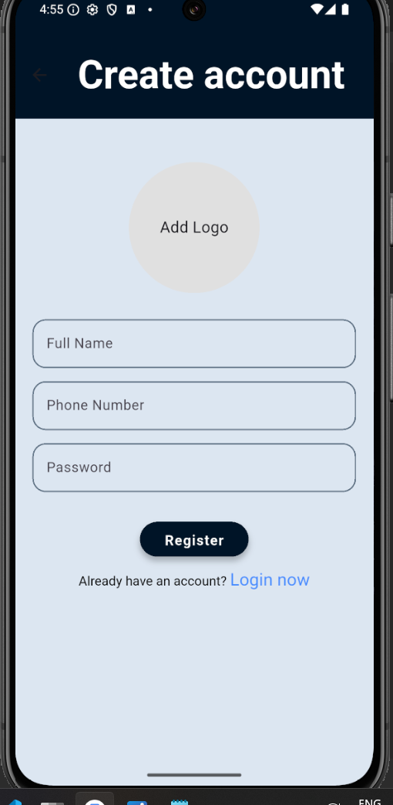
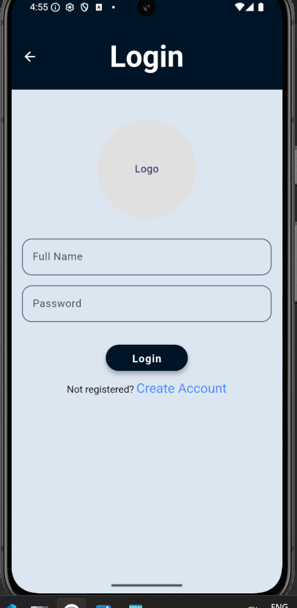
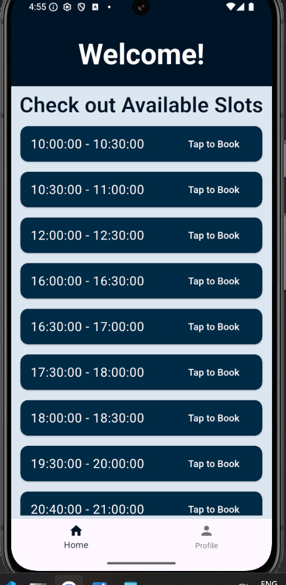
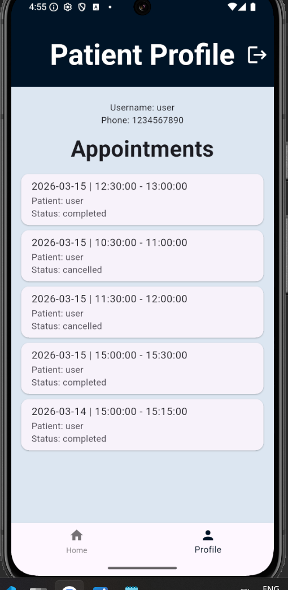
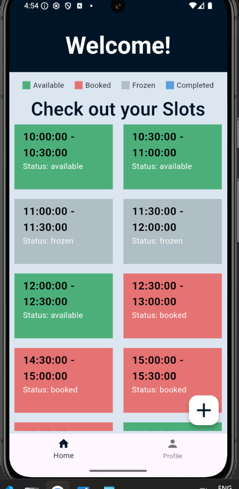
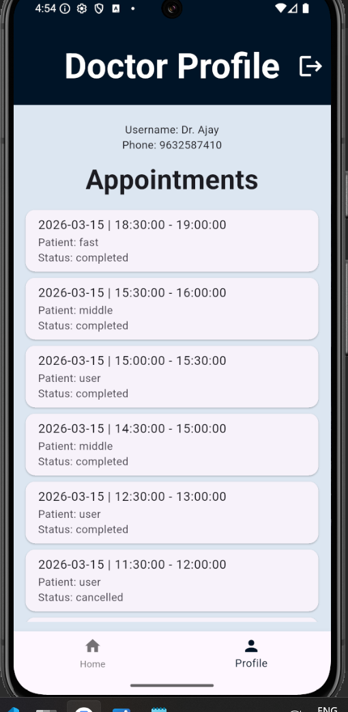

# DocAppoint - Frontend

A Flutter frontend for the DocAppoint appointment system. It supports patient booking and doctor scheduling workflows.

## Tech Stack
- Flutter
- Dart
- HTTP API integration
- JWT-based authentication
- SharedPreferences for session storage

## Features
Patient:
- Register and login
- View available slots
- Book an appointment
- Cancel an appointment
- View appointment history

Doctor:
- Login
- Generate appointment slots
- View all slots
- Freeze/unfreeze slots
- See patient details
- Mark appointment as completed

## Screens
- Login
- Register
- Patient Home
- Patient Profile
- Doctor Home
- Doctor Profile

## Prerequisites
- Flutter SDK installed
- An active backend API instance
- Android Studio / Xcode / emulator device for local testing

## Environment setup
The app uses a configurable backend URL through a Dart define.

For local development:

```bash
flutter run --dart-define=API_BASE_URL=https://your-backend-url
```

For production release builds:

```bash
flutter build apk --release --dart-define=API_BASE_URL=https://your-production-backend-url
```

You can also use a staging backend by swapping the value in the command.

## Install dependencies

```bash
git clone https://github.com/codingPurnima/doc_appoint_frontend.git
cd doc_appoint_frontend
flutter pub get
```

## Run the app

```bash
flutter run
```

If you want to override the backend URL for a specific run:

```bash
flutter run --dart-define=API_BASE_URL=https://your-backend-url
```

## Environment-safe release configuration

This project uses compile-time environment values for API configuration instead of hardcoding release endpoints in source.

### Required build arguments
- `APP_ENV` = `dev` | `staging` | `prod`
- `API_BASE_URL` = your backend URL for that environment

### Examples

Development:

```bash
flutter run --dart-define=APP_ENV=dev --dart-define=API_BASE_URL=https://your-dev-backend-url
```

Staging:

```bash
flutter run --dart-define=APP_ENV=staging --dart-define=API_BASE_URL=https://your-staging-backend-url
```

Production release:

```bash
flutter build apk --release --dart-define=APP_ENV=prod --dart-define=API_BASE_URL=https://doc-appoint-backend-meb4.onrender.com
```

### Windows PowerShell helper

Use the included script for a consistent release build:

```powershell
powershell -ExecutionPolicy Bypass -File .\scripts\build_release.ps1 -Environment prod -Target apk
powershell -ExecutionPolicy Bypass -File .\scripts\build_release.ps1 -Environment staging -Target appbundle
```

Edit the URLs inside `scripts/build_release.ps1` to match your real dev/staging/prod backends before release.

## Production readiness notes
- The API base URL is environment-driven and should not be hardcoded for different environments.
- Auth tokens are stored in secure storage (`flutter_secure_storage`) and cleared on logout.
- HTTP requests include a timeout to avoid long hangs on slow or failed backend connections.
- Always verify the API is served over HTTPS in production.

## Android Release & Signing

For detailed Android signing and release instructions, see:
- [ANDROID_SIGNING_SETUP.md](ANDROID_SIGNING_SETUP.md) — Generate and configure your release keystore
- [ANDROID_RELEASE_BUILD.md](ANDROID_RELEASE_BUILD.md) — Build and submit to Google Play Store

Quick release build:

```bash
flutter build appbundle --release --dart-define=APP_ENV=prod --dart-define=API_BASE_URL=https://doc-appoint-backend-meb4.onrender.com
```

Output: `build/app/outputs/bundle/release/app-release.aab` (ready for Play Store)

## Backend Repository
Backend API is available here:

https://github.com/codingPurnima/doc_appoint_backend.git

## Screenshots

### Register


### Login


### Patient Home


### Patient Profile


### Doctor Home


### Doctor Profile

